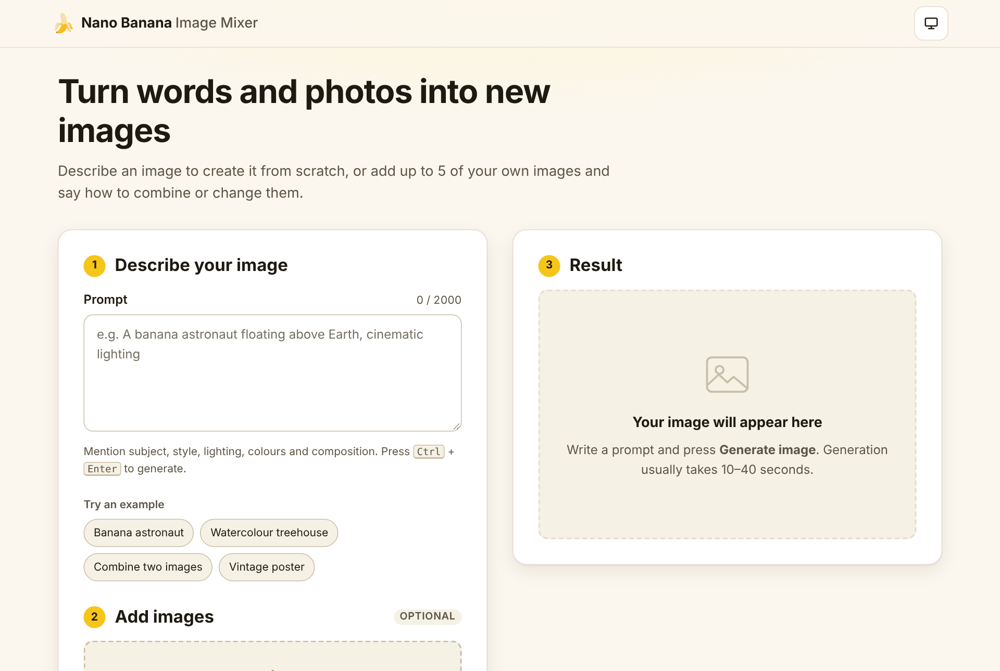
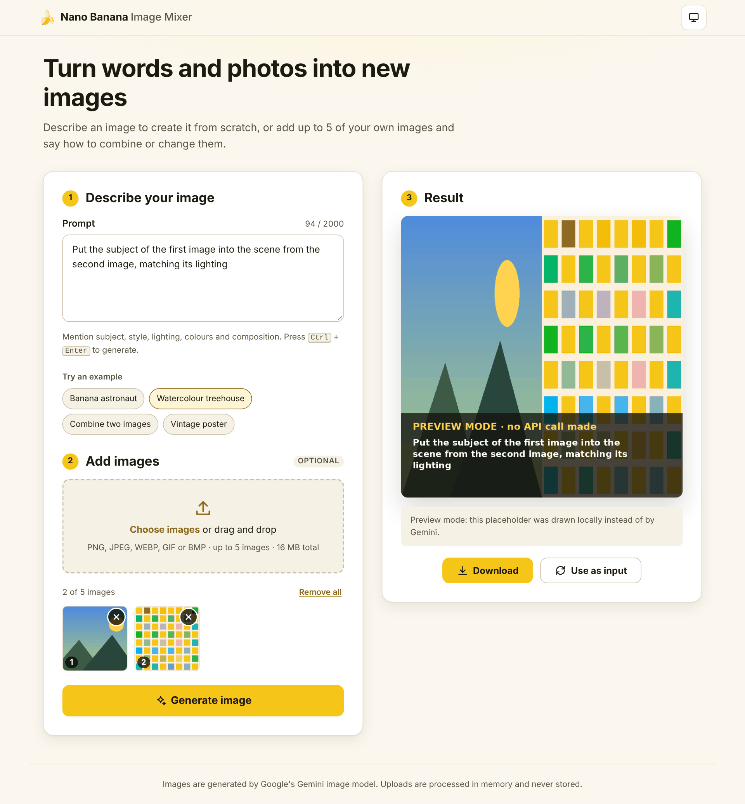
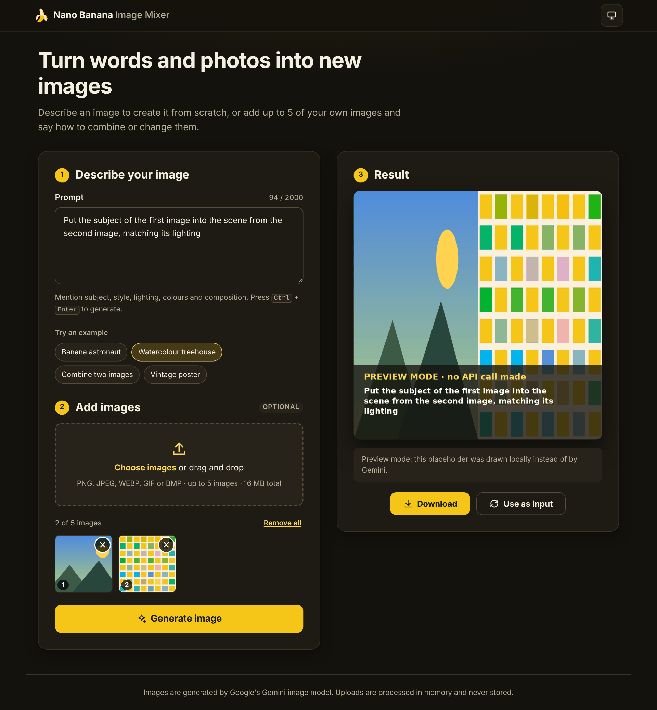
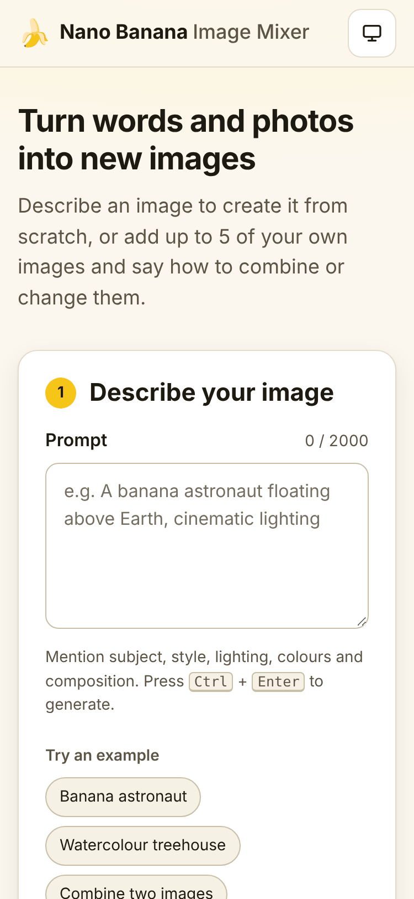
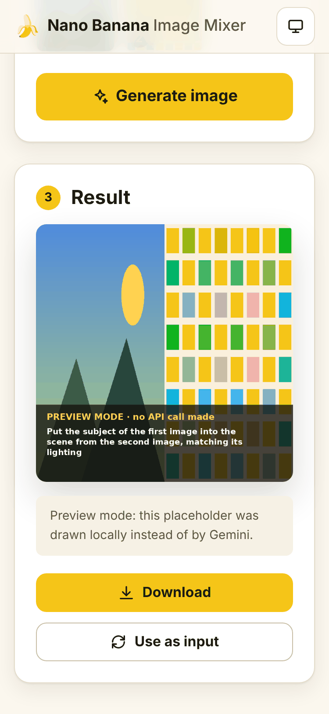
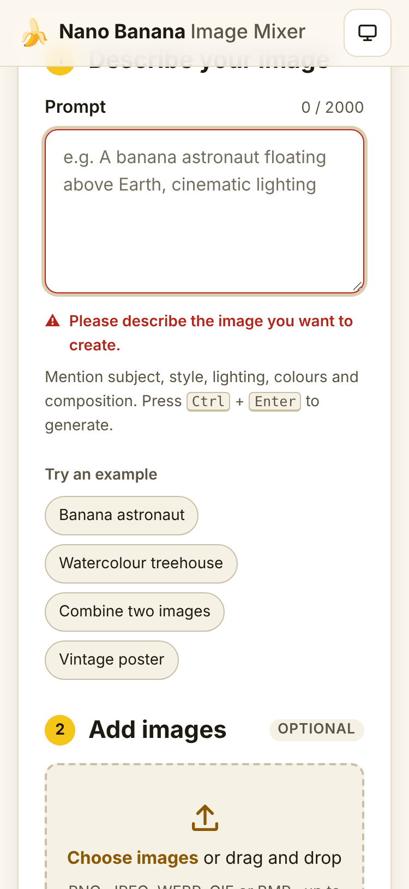
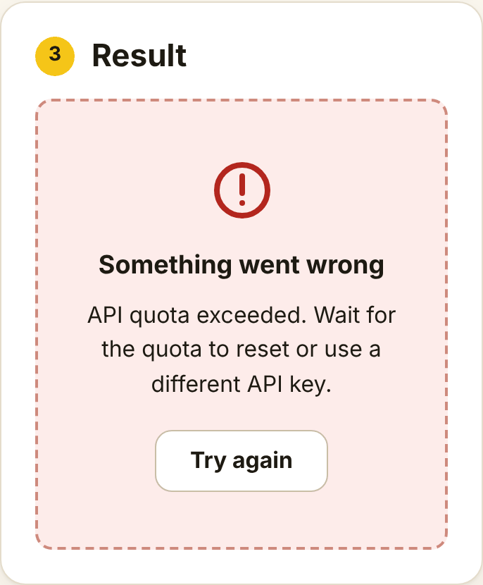
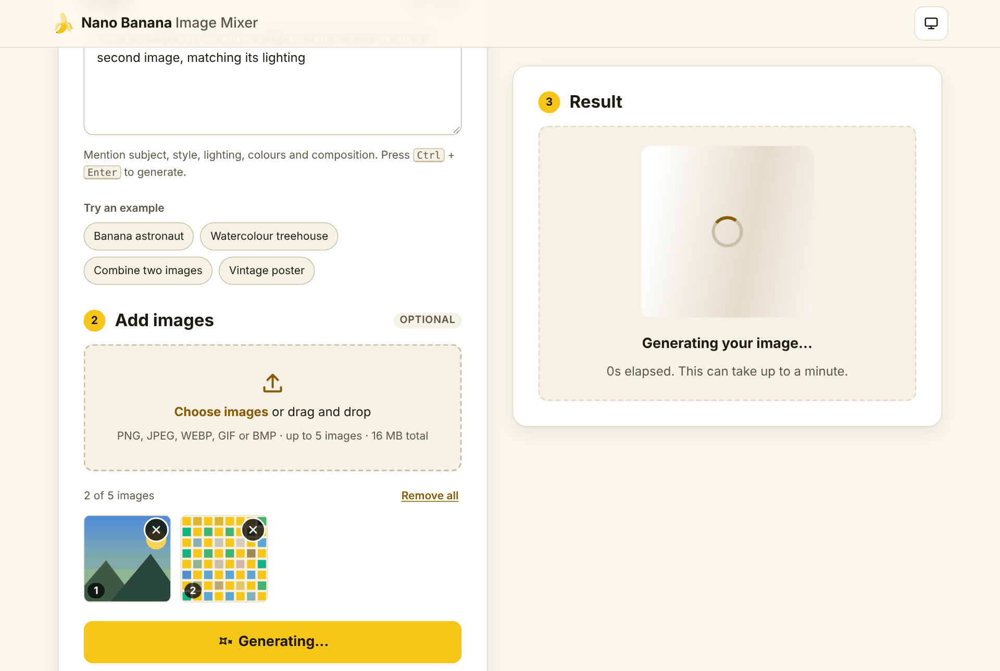
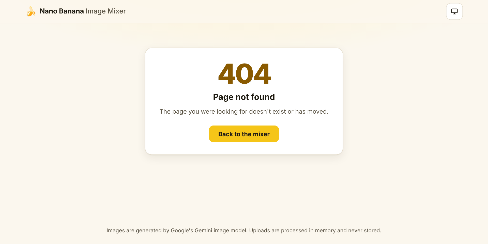
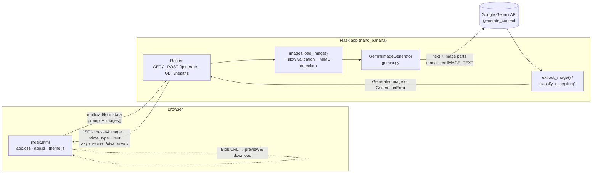

# 🍌 Nano Banana Image Mixer

**Generate images from a text prompt, or remix up to five of your own images, using Google's Gemini image model ("Nano Banana"). All from a small, self-hosted Flask web app.**




---

## Contents

- [Overview](#overview)
- [Screenshots](#screenshots)
- [Features](#features)
- [Tech stack](#tech-stack)
- [Architecture](#architecture)
- [Project structure](#project-structure)
- [Getting started](#getting-started)
- [Configuration](#configuration)
- [Running the app](#running-the-app)
- [Usage](#usage)
- [HTTP API](#http-api)
- [Scripts and commands](#scripts-and-commands)
- [Testing](#testing)
- [Linting and formatting](#linting-and-formatting)
- [Deployment](#deployment)
- [Security notes](#security-notes)
- [Troubleshooting and FAQ](#troubleshooting-and-faq)
- [Known limitations](#known-limitations)
- [Roadmap ideas](#roadmap-ideas)
- [Contributing](#contributing)
- [License](#license)

---

## Overview

Google's Gemini image models can create new images from text and edit or combine existing
images. Using them usually means writing code against the API. **Nano Banana Image Mixer**
puts a browser UI in front of that API, so you can:

- type a description and get an image back, or
- drop in one to five reference images (a person, a product, a style, a scene) and describe
  how to combine or change them.

**Who it's for:** developers, designers and hobbyists who have a Gemini API key and want a
quick, private playground they can run locally or deploy for a small team, without a
frontend build step or a database.

**How it behaves:** the server is stateless. Uploads and generated images stay in memory for
the length of one request and are never written to disk. Your API key stays on the server
and is never sent to the browser.

---

## Screenshots

All screenshots were taken from the running app with Playwright. Because no Gemini key was
available while they were captured, the result images come from the bundled
[offline preview server](#offline-preview-mode), which draws a placeholder labelled
**"PREVIEW MODE · no API call made"** instead of calling Gemini. Everything else (layout,
states, validation and error messages) is the real UI.

| Desktop, light theme (result) | Desktop, dark theme (result) |
| --- | --- |
|  |  |

| Phone: start | Phone: result | Phone: validation | Phone: error state |
| --- | --- | --- | --- |
|  |  |  |  |

| Loading state | 404 page |
| --- | --- |
|  |  |

---

## Features

**Generation**
- **Text to image:** describe an image and generate it.
- **Image mixing and editing:** upload 1–5 images (PNG, JPEG, WEBP, GIF or BMP) and describe
  how to combine or change them. GIF and BMP are converted to PNG on the server because
  Gemini doesn't accept them directly.
- **Iterate on a result:** "Use as input" adds the generated image to your inputs so you can
  refine it with a new prompt.
- **Download** the result with the correct file extension for the format the model returned.
- **Model commentary:** any text the model returns alongside the image is shown under it.

**Interface**
- Two-column workspace on desktop (composer on the left, sticky result panel on the right)
  that stacks into a single column on phones and tablets.
- Light, dark and "follow system" themes, switchable from the header and remembered per browser.
- Clear **empty, loading, error and success** states. Loading shows an elapsed-time counter.
  Errors show a plain-language message and a **Try again** button.
- Inline validation: empty prompt, unsupported file types, too many images and total upload
  size are caught before anything is sent.
- Prompt character counter, one-click example prompts, drag-and-drop uploads, numbered
  thumbnails with per-image remove and "Remove all".
- Keyboard shortcut: <kbd>Ctrl</kbd>/<kbd>⌘</kbd> + <kbd>Enter</kbd> generates from the prompt box.
- Branded 404 page, favicon, apple-touch icon, meta description and Open Graph/Twitter card.

**Accessibility**
- Semantic landmarks, a skip link and a logical tab order.
- Every control is labelled. Thumbnails have alt text, and remove buttons name the image they remove.
- Status changes (adding images, generating, done) are announced through a polite live region.
  Errors use `role="alert"`, and focus moves to the result panel when a request finishes.
- Visible focus rings, 44 px touch targets and a respected `prefers-reduced-motion` setting.
- Colour tokens checked against WCAG AA (body text ≈16:1, muted text ≥6.5:1, accent text ≥5.2:1
  in both themes).

**Backend**
- File content is checked with Pillow, and the MIME type comes from the bytes, never from the
  filename or the browser.
- Server-side limits for image count, prompt length and total upload size.
- Typed, user-friendly errors with matching HTTP status codes. Upstream details are logged on
  the server and never sent to the browser.
- Security headers: Content Security Policy (self only), `X-Frame-Options: DENY`, `nosniff`
  and `Referrer-Policy`.
- Starts without an API key: the page shows a "Server not configured" banner and the API
  returns 503, so a misconfiguration is obvious instead of crashing the app.
- `/healthz` endpoint for load balancers and uptime checks.

---

## Tech stack

| Layer | Technology | Notes |
| --- | --- | --- |
| Language | Python 3.10+ | Tested on 3.13 |
| Web framework | [Flask 3](https://flask.palletsprojects.com/) | App factory pattern (`create_app`) |
| AI | [Google Gen AI SDK](https://github.com/googleapis/python-genai) (`google-genai`) | Default model `gemini-2.5-flash-image` |
| Image handling | [Pillow](https://python-pillow.org/) | Validation, format detection, GIF/BMP → PNG |
| Config | [python-dotenv](https://github.com/theskumar/python-dotenv) | Loads `.env` in development |
| Frontend | Jinja templates, plain CSS and vanilla JavaScript | No build step, no external CDNs |
| Production server | [Gunicorn](https://gunicorn.org/) | Config in `gunicorn.conf.py` |
| Tests | [pytest](https://pytest.org/) | Gemini is faked, so no key or network is needed |
| Lint and format | [Ruff](https://docs.astral.sh/ruff/) | Rules: E, F, W, I, B, UP, SIM, RUF |

---

## Architecture



**Request lifecycle**

1. The browser checks the input locally (non-empty prompt, file types, count, total size) and
   posts `multipart/form-data` to `POST /generate`.
2. Flask enforces the same limits again. `MAX_CONTENT_LENGTH` rejects oversized bodies with a
   413 before they're read.
3. Each upload goes through `images.load_image()`. Pillow verifies it's a real image, the
   MIME type comes from its content, and GIF/BMP are converted to PNG.
4. `GeminiImageGenerator.generate()` sends the prompt and image parts to
   `client.models.generate_content` with `response_modalities=["IMAGE", "TEXT"]`.
5. `extract_image()` returns the first inline image found in any part of any candidate. If
   there isn't one, it raises a typed `GenerationError` (safety block, no image, and so on).
   SDK exceptions are mapped to quota, invalid-key or generic upstream errors.
6. The response is JSON with the image base64-encoded. The browser turns it into a Blob URL
   to display and download it. Nothing is stored on the server.

**Key design decisions**

- **Stateless by design:** no disk writes and no sessions, so it runs on read-only file systems
  and scales horizontally without shared storage.
- **Dependency injection:** `create_app(settings=..., generator=...)` accepts any object with a
  `generate(prompt, images)` method. Tests and the preview server use this to swap Gemini out.
- **Strict CSP:** all CSS and JS are served from `static/` (no inline scripts or styles), which
  is why the theme is applied by a tiny `theme.js` in `<head>`.

---

## Project structure

```
.
├── nano_banana/                 # the application package
│   ├── __init__.py              # create_app() factory: routes, error handlers, security headers
│   ├── __main__.py              # dev server entry point: `python -m nano_banana`
│   ├── config.py                # Settings dataclass, reads and validates env vars
│   ├── gemini.py                # Gemini client wrapper, response parsing, error classification
│   ├── images.py                # upload validation, MIME detection, GIF/BMP → PNG
│   ├── templates/
│   │   ├── base.html            # shared layout: meta/OG tags, header, theme toggle, footer
│   │   ├── index.html           # the mixer: composer form and result panel states
│   │   └── 404.html             # branded not-found page
│   └── static/
│       ├── app.css              # design tokens (spacing, type, colour, motion) and components
│       ├── app.js               # uploads, previews, validation, submit, result states
│       ├── theme.js             # light/dark/system theme, applied before first paint
│       ├── favicon.svg          # 🍌 favicon
│       ├── apple-touch-icon.png # home-screen icon
│       └── og-image.png         # 1200×630 social preview card
├── scripts/
│   ├── preview_server.py        # offline UI with a stub generator (no key, no quota)
│   └── smoke_test.py            # one real API call to check your key and model
├── tests/                       # pytest suite (Gemini faked)
│   ├── conftest.py              # fixtures: settings, FakeGenerator, test client
│   ├── test_app.py              # routes, status codes, headers, templates
│   ├── test_config.py           # env parsing and validation
│   ├── test_gemini.py           # SDK call shape, response parsing, error mapping
│   ├── test_images.py           # image validation and conversion
│   └── test_preview_server.py   # placeholder rendering and stub errors
├── docs/screenshots/            # README screenshots (captured from the running app)
├── wsgi.py                      # production entry point: `gunicorn wsgi:app`
├── gunicorn.conf.py             # bind 0.0.0.0:$PORT, workers, 120 s timeout
├── pyproject.toml               # project metadata, Ruff and pytest config
├── requirements.txt             # runtime dependencies
├── requirements-dev.txt         # runtime + pytest + ruff
└── .env.example                 # template for your local .env
```

---

## Getting started

### Prerequisites

| Requirement | Version | Check with |
| --- | --- | --- |
| Python | 3.10 or newer | `python3 --version` |
| pip | any recent | `python3 -m pip --version` |
| Gemini API key | – | Create one at [Google AI Studio](https://aistudio.google.com/app/apikey) |

A key is only needed for real generation. You can run the UI and the test suite without one.

### Installation

1. **Clone the repository**

   ```bash
   git clone https://github.com/jeevithg090/Nano-Banana.git
   cd Nano-Banana
   ```

2. **Create and activate a virtual environment**

   ```bash
   python3 -m venv .venv
   source .venv/bin/activate          # Windows (PowerShell): .venv\Scripts\Activate.ps1
   ```

3. **Install dependencies**

   ```bash
   pip install -r requirements-dev.txt   # app + pytest + ruff
   # or, runtime only:
   pip install -r requirements.txt
   ```

4. **Configure your environment**

   ```bash
   cp .env.example .env
   ```

   Open `.env` and set `GEMINI_API_KEY`. Every other value has a sensible default (see
   [Configuration](#configuration)).

5. **Check your key (optional, makes one real API call)**

   ```bash
   python scripts/smoke_test.py "a banana wearing a superhero costume"
   # Model: gemini-2.5-flash-image
   # Prompt: a banana wearing a superhero costume
   # Saved 1234567 bytes to generated/smoke.png
   ```

6. **Start the app**

   ```bash
   python -m nano_banana
   ```

   Open <http://127.0.0.1:5000>.

---

## Configuration

Settings come from environment variables. In development, a `.env` file in the project root is
loaded automatically (by `python -m nano_banana`, `wsgi.py` and the scripts). Invalid numeric
values (non-integers or values ≤ 0) stop the app at startup with a clear error.

| Variable | Required | Default | Used by | Description |
| --- | --- | --- | --- | --- |
| `GEMINI_API_KEY` | **Yes** for generation | – | app, smoke test | Google AI Studio API key. If unset, the app still starts, shows a "Server not configured" banner and `/generate` returns 503. |
| `GEMINI_MODEL` | No | `gemini-2.5-flash-image` | app, smoke test | Any Gemini model that supports image output. |
| `FLASK_SECRET_KEY` | No | random per process | app | Flask secret key. The app keeps no login sessions, but set a fixed value in production anyway. Generate one with `python -c "import secrets; print(secrets.token_hex(32))"`. |
| `MAX_IMAGES` | No | `5` | app | Maximum images per request (enforced in the browser and on the server). |
| `MAX_UPLOAD_MB` | No | `16` | app | Maximum total request size in MB. Larger requests get a JSON 413. |
| `MAX_PROMPT_CHARS` | No | `2000` | app | Maximum prompt length in characters. |
| `HOST` | No | `127.0.0.1` | dev server | Bind address for `python -m nano_banana`. |
| `PORT` | No | `5000` (dev) / `8000` (Gunicorn) | dev server, Gunicorn | Port to listen on. |
| `FLASK_DEBUG` | No | `0` | dev server | `1`/`true`/`yes` enables the Werkzeug debugger. **Never enable it on a public host.** |
| `WEB_CONCURRENCY` | No | `2` | Gunicorn | Number of worker processes. |
| `GUNICORN_TIMEOUT` | No | `120` | Gunicorn | Worker timeout in seconds. Image generation can take longer than Gunicorn's 30 s default. |

---

## Running the app

### Development

```bash
python -m nano_banana                    # http://127.0.0.1:5000
HOST=0.0.0.0 PORT=8080 python -m nano_banana   # reachable from your LAN
FLASK_DEBUG=1 python -m nano_banana      # auto-reload + debugger (local only)
```

### Offline preview mode

Work on the UI, give a demo or take screenshots without a key and without spending quota:

```bash
python scripts/preview_server.py                 # http://127.0.0.1:5001
python scripts/preview_server.py --delay 5       # simulate a slow generation
python scripts/preview_server.py --fail          # every request returns the quota error
```

The stub generator returns a locally drawn placeholder (your input images tiled, or a
gradient) with your prompt and a **"PREVIEW MODE · no API call made"** label. Validation,
limits and error handling are the real app code.

### Production

```bash
pip install -r requirements.txt
export GEMINI_API_KEY=your-key FLASK_SECRET_KEY=$(python -c "import secrets; print(secrets.token_hex(32))")
gunicorn wsgi:app                         # picks up gunicorn.conf.py, binds 0.0.0.0:${PORT:-8000}
```

---

## Usage

### In the browser

1. **Describe your image.** Type a prompt, or click one of the example chips to fill it in.
   The counter shows how much of the prompt limit you've used.
2. **Add images (optional).** Click the drop zone or drag files onto it. Up to five PNG, JPEG,
   WEBP, GIF or BMP files. Thumbnails are numbered so you can refer to them in the prompt
   ("the subject of image 1…"). Remove one with its × button, or all of them with **Remove all**.
3. **Generate.** Click **Generate image** or press <kbd>Ctrl</kbd>/<kbd>⌘</kbd> + <kbd>Enter</kbd>.
   The result panel shows a progress state with elapsed seconds (usually 10–40 s).
4. **Use the result.** **Download** saves it with the right extension. **Use as input** adds it
   to your images so you can refine it with a follow-up prompt.
5. **If something goes wrong,** the result panel explains what happened (quota, safety
   filter, invalid key, network) and offers **Try again**.

Use the button in the top-right corner to cycle the theme: system → light → dark.

### Prompt tips

- Be specific about **subject, setting, style, lighting, colours and composition**.
- When mixing, say what each image contributes: *"Put the person from image 1 into the beach
  scene from image 2, in watercolour style, warm sunset light."*
- For edits, describe the change and what to keep: *"Replace the background with a snowy
  forest. Keep the dog exactly as it is."*
- If you get "the model did not return an image", make the prompt more explicit that you want
  an image (*"Generate an image of…"*).

### From the command line

```bash
# Text to image; jq + base64 decode the image to a file
curl -s -X POST http://127.0.0.1:5000/generate \
  -F 'prompt=A banana astronaut floating above Earth, cinematic lighting' \
  | jq -r .image | base64 --decode > banana.png

# Mix two images
curl -s -X POST http://127.0.0.1:5000/generate \
  -F 'prompt=Put the subject of the first image into the scene from the second' \
  -F images=@subject.jpg -F images=@scene.png \
  | jq -r .image | base64 --decode > mixed.png
```

---

## HTTP API

| Method | Path | Auth | Description |
| --- | --- | --- | --- |
| `GET` | `/` | None | The web UI. |
| `POST` | `/generate` | None | Generate an image from a prompt and optional images. Returns JSON. |
| `GET` | `/healthz` | None | Liveness check. Returns `{"status": "ok"}`. Doesn't call Gemini. |
| `GET` | `/static/<file>` | None | CSS, JS and icons. |

Any other path returns the HTML 404 page. Any error on `/generate` is JSON.

### `POST /generate`

**Request:** `multipart/form-data`

| Field | Type | Required | Notes |
| --- | --- | --- | --- |
| `prompt` | text | Yes | Trimmed. 1 to `MAX_PROMPT_CHARS` characters. |
| `images` | file (repeatable) | No | 0 to `MAX_IMAGES` files. PNG, JPEG, WEBP, GIF or BMP, detected from content. |

**Success: `200 OK`**

```json
{
  "success": true,
  "image": "iVBORw0KGgoAAAANSUhEUgAAAwAAAAMACAIAAAAc45fZ...",
  "mime_type": "image/png",
  "text": "Optional text the model returned with the image, or null"
}
```

**Errors:** always `{"success": false, "error": "<message for the user>"}`

| Status | When | Example `error` |
| --- | --- | --- |
| `400` | Empty or too-long prompt, too many images, invalid or unsupported file | `"Please enter a prompt."`, `"notes.txt is not a valid image."` |
| `405` | Wrong method (for example `GET /generate`) | `"The method is not allowed for the requested URL."` |
| `413` | Request body over `MAX_UPLOAD_MB` | `"Upload is too large (max 16 MB in total)."` |
| `422` | Blocked by Gemini's safety filters | `"The request was blocked by the model's safety filters. Try rephrasing your prompt."` |
| `429` | Gemini quota or rate limit exceeded | `"API quota exceeded. Wait for the quota to reset or use a different API key."` |
| `500` | Unexpected server error (details are logged) | `"An unexpected error occurred."` |
| `502` | Key rejected, no image returned, or other upstream failure | `"The Gemini API key was rejected. Check GEMINI_API_KEY."` |
| `503` | No `GEMINI_API_KEY` configured | `"The server is not configured with a GEMINI_API_KEY."` |

---

## Scripts and commands

| Command | What it does |
| --- | --- |
| `python -m nano_banana` | Start the development server (`HOST`/`PORT`/`FLASK_DEBUG`). |
| `gunicorn wsgi:app` | Start the production server using `gunicorn.conf.py`. |
| `python scripts/preview_server.py [--port N] [--delay S] [--fail]` | Offline UI with a stub generator. No key needed, no quota used. |
| `python scripts/smoke_test.py "prompt" [-o out.png]` | One real Gemini call to check your key and model. Saves to `generated/`. |
| `pytest` | Run the test suite. |
| `ruff check .` | Lint. |
| `ruff format .` / `ruff format --check .` | Format the code, or check formatting without changing files. |

---

## Testing

```bash
pip install -r requirements-dev.txt
pytest            # 46 tests, about half a second, no network or API key required
pytest -k generate -v   # run a subset verbosely
```

What's covered:

- **Routes and HTTP behaviour** (`test_app.py`): page rendering and metadata, static assets,
  `/healthz`, successful generation with and without images, error responses and status codes
  (400/405/413/429/500/503), the branded 404 page, security headers, and the "not
  configured" banner.
- **Image validation** (`test_images.py`): real versus fake images, MIME detection from
  content, GIF/BMP conversion, empty and unsupported files.
- **Gemini wrapper** (`test_gemini.py`): the exact SDK call shape (with a fake client),
  finding images in any part or candidate, safety-block detection (422) and exception
  classification (quota, invalid key, upstream).
- **Config** (`test_config.py`): defaults, overrides and validation of numeric env vars.
- **Preview server** (`test_preview_server.py`): placeholder rendering and the forced-error mode.

Not covered automatically: real calls to Gemini (use `scripts/smoke_test.py`) and in-browser
behaviour. The UI was checked by hand with Playwright at 375 px, 768 px and 1280 px, in light
and dark themes, through the main flows (validation, upload, generate, use as input, remove,
error and retry, 404), with no console errors and no horizontal scrolling.

---

## Linting and formatting

[Ruff](https://docs.astral.sh/ruff/) handles both, configured in `pyproject.toml` (line
length 100, target Python 3.10, rules `E, F, W, I, B, UP, SIM, RUF`).

```bash
ruff check .            # lint
ruff check . --fix      # auto-fix what it can
ruff format .           # format
```

The frontend is plain CSS and JS with no build tooling.

---

## Deployment

The app is a standard WSGI application exposed as `wsgi:app`. `gunicorn.conf.py` is picked up
automatically and:

- binds to `0.0.0.0:$PORT` (default `8000`)
- runs `$WEB_CONCURRENCY` workers (default `2`)
- sets a `$GUNICORN_TIMEOUT` of 120 s, because image generation regularly takes longer than
  Gunicorn's 30 s default
- writes access logs to stdout

### Generic steps (any Python host)

1. Set the start command to `gunicorn wsgi:app`.
2. Set the environment variables `GEMINI_API_KEY` and `FLASK_SECRET_KEY` (plus any optional
   limits from [Configuration](#configuration)).
3. Point the platform's health check at `GET /healthz`.
4. Make sure any reverse proxy or load balancer in front allows **request bodies of at least
   `MAX_UPLOAD_MB`** and a **read timeout of at least 120 s**.

This works on any platform that runs a Python web process, such as Render, Railway, Fly.io,
Heroku, Google Cloud Run, or a VM. The repo doesn't include platform-specific files (Dockerfile,
Procfile and so on), so add whatever your platform needs. For example, a Procfile is one line:
`web: gunicorn wsgi:app`.

### Behind nginx (example)

```nginx
server {
    listen 80;
    server_name example.com;
    client_max_body_size 16m;          # match MAX_UPLOAD_MB

    location / {
        proxy_pass http://127.0.0.1:8000;
        proxy_read_timeout 130s;       # longer than GUNICORN_TIMEOUT
        proxy_set_header Host $host;
        proxy_set_header X-Forwarded-Proto $scheme;
    }
}
```

---

## Security notes

- **Your API key stays server-side.** The browser only talks to this app, never to Gemini.
- **Uploads are verified** with Pillow, and their type comes from the bytes. Nothing is written
  to disk.
- **Headers:** a strict CSP (`default-src 'self'`, no inline scripts), `X-Frame-Options: DENY`,
  `X-Content-Type-Options: nosniff` and `Referrer-Policy: same-origin`.
- **No authentication or rate limiting is built in.** Anyone who can reach the app can spend
  your Gemini quota. Before exposing it publicly, put it behind a login (an identity-aware
  proxy, basic auth at nginx and so on) and/or a rate limiter.
- Keep `FLASK_DEBUG` off anywhere other than your own machine.

---

## Troubleshooting and FAQ

**The page says "Server not configured" and the button is disabled.**
`GEMINI_API_KEY` isn't set in the server's environment. Add it to `.env` (development) or to
your host's environment variables, then restart.

**"The Gemini API key was rejected. Check GEMINI_API_KEY."**
The key is wrong, revoked, or doesn't have access to the Generative Language API. Create a new
one in [Google AI Studio](https://aistudio.google.com/app/apikey) and check it with
`python scripts/smoke_test.py`.

**"API quota exceeded."**
You've hit your project's rate limit or quota. Wait for it to reset, check your usage in
Google AI Studio, or use a key from a project with more quota.

**"The model did not return an image."**
The model replied with text only. Make the prompt explicitly ask for an image, add detail, or
check that `GEMINI_MODEL` is a model that supports image output.

**"The request was blocked by the model's safety filters."**
Gemini refused the prompt or input images. Rephrase the prompt or use different images.

**Requests fail after about 30 seconds in production.**
Something in front of the app has a shorter timeout than generation needs. Gunicorn is already
set to 120 s, so raise your proxy's or platform's request timeout too.

**"Upload is too large."**
The total request is over `MAX_UPLOAD_MB` (16 MB by default). Use smaller or fewer images, or
raise the limit (and your proxy's body-size limit).

**`ValueError: MAX_IMAGES must be a positive integer`** at startup.
A numeric env var has an invalid value. Fix or remove it in `.env`.

**`ModuleNotFoundError: No module named 'flask'` (or `google`).**
The virtual environment isn't active, or dependencies aren't installed. Run
`source .venv/bin/activate && pip install -r requirements.txt`.

**Port 5000 is already in use (common on macOS, where AirPlay Receiver uses it).**
Run `PORT=5050 python -m nano_banana`.

**Does it store my images?**
No. Uploads and results live in memory for the length of one request. Images are sent to
Google's Gemini API to be processed, under Google's terms for your API key.

**Can I try the UI without a key?**
Yes: `python scripts/preview_server.py`.

---

## Known limitations

- **No authentication, rate limiting or usage accounting.** See [Security notes](#security-notes).
- **One image per request.** The app returns the first image in the response, even if the
  model sends more than one.
- **No history.** Results aren't saved. Download what you want to keep before generating again
  or closing the tab.
- **Synchronous requests.** Each generation holds a Gunicorn worker for its whole duration
  (often 10–40 s). Raise `WEB_CONCURRENCY` for more simultaneous users.
- **Base64 transport** makes responses about 33% larger than the image itself.
- **No in-browser test suite.** UI behaviour was checked with Playwright by hand, not in CI.
- **Real generation wasn't verified for this release.** No valid Gemini key was available.
  The SDK call shape is unit-tested and an invalid-key call was checked against the live API.
  If the default model isn't available to your account, set `GEMINI_MODEL`.

## Roadmap ideas

- Optional login and per-user rate limiting.
- Session history of recent generations (client-side, for example IndexedDB).
- Aspect-ratio and output-size controls, once supported by the chosen model.
- Streaming progress or an async job queue for long generations.
- A Dockerfile and a CI workflow running `ruff` and `pytest`.
- Playwright end-to-end tests against the preview server.

---

## Contributing

Contributions are welcome.

1. Fork the repo and create a branch: `git checkout -b feat/my-change`.
2. Install dev dependencies: `pip install -r requirements-dev.txt`.
3. Make your change. For UI work, `python scripts/preview_server.py` gives you a working app
   without a key.
4. Make sure everything passes:

   ```bash
   ruff check . && ruff format --check . && pytest
   ```

5. Commit using [Conventional Commits](https://www.conventionalcommits.org/) (`feat:`, `fix:`,
   `docs:`, `test:`, `refactor:` …) and open a pull request describing what changed and how
   you tested it. Include screenshots for visual changes.

Please keep the frontend dependency-free (no CDNs; the CSP blocks them) and keep new server
code covered by tests that use the fake generator.

---

## License

This repository doesn't include a license file yet, which means all rights are reserved by
default. If you want others to use, modify or redistribute it, consider adding a permissive
license such as [MIT](https://choosealicense.com/licenses/mit/) or
[Apache-2.0](https://choosealicense.com/licenses/apache-2.0/).

"Gemini" and "Nano Banana" refer to Google's image model. This project isn't affiliated with or
endorsed by Google.
